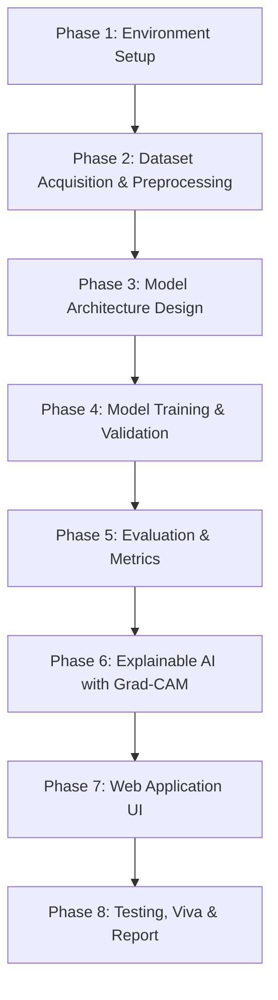

# 🩺 MedVision AI — Comprehensive Project Handbook & Roadmap
> **Explainable Chest X-Ray Classification Using Deep Learning (PyTorch + Grad-CAM + Streamlit)**  
> *Final Year B.Tech Computer Science / AI & Data Science Project Guide*

---

## 📌 Table of Contents
1. [Project Overview & Medical Significance](#1-project-overview--medical-significance)
2. [Why Explainability (XAI) Matters in Healthcare](#2-why-explainability-xai-matters-in-healthcare)
3. [End-to-End Project Roadmap (Phases 1 to 8)](#3-end-to-end-project-roadmap)
4. [Architecture & Technology Stack](#4-architecture--technology-stack)
5. [Directory Structure Explained](#5-directory-structure-explained)
6. [Core Theoretical Concepts (Viva / Defense Guide)](#6-core-theoretical-concepts)
7. [Step-by-Step Execution Guide](#7-step-by-step-execution-guide)
8. [Frequently Asked Viva / Interview Questions & Answers](#8-frequently-asked-viva--interview-questions)

---

## 1. Project Overview & Medical Significance

### The Clinical Problem
Pneumonia is an infection that inflames the air sacs in one or both lungs, leading to millions of hospitalizations globally each year. Diagnosing pneumonia requires evaluating Chest X-Ray (CXR) radiograms. However:
- Expert radiologists are in short supply in rural and under-resourced healthcare facilities.
- Fatigue and high workload can lead to human diagnostic errors.
- Fast, automated triage is critical in emergency care settings.

### The MedVision Solution
MedVision AI is an end-to-end computer vision system that:
1. **Analyzes Chest X-Ray Radiograms**: Classifies images as **NORMAL** or **PNEUMONIA** with high sensitivity and specificity.
2. **Utilizes Transfer Learning**: Leverages deep pretrained feature extractors (ResNet-18 / ResNet-50) alongside a custom baseline CNN built from scratch for comparative evaluation.
3. **Explains Its Decisions**: Generates **Grad-CAM visual heatmaps** showing the exact anatomical regions of the lung that contributed to the model's diagnosis.
4. **Provides a Clinical Web Interface**: Offers a medical-grade Streamlit web app for doctors and medical staff to upload images and inspect visual explanations in real time.

---

## 2. Why Explainability (XAI) Matters in Healthcare

In traditional deep learning, a neural network is a **"black box"**: you input an image, and it outputs `PNEUMONIA: 98%`.

**Why this fails in clinical practice:**
- A model might learn "shortcuts" or dataset artifacts (e.g., hospital watermark tags, border brightness, or radiology markers like "L" and "R") instead of lung pathology.
- Doctors cannot legally or ethically rely on AI predictions without verifiable reasoning.

**How MedVision AI solves this:**
Using **Grad-CAM (Gradient-weighted Class Activation Mapping)**:
- MedVision AI calculates the gradient of the predicted class score with respect to the last convolutional feature map.
- It highlights the specific lung areas (e.g., consolidation or opacity in lower lobes) that drove the classification.
- A radiologist can instantly cross-verify whether the AI identified genuine medical pathology or spurious background noise.

---

## 3. End-to-End Project Roadmap



### Phase 1: Environment & Tooling Setup ✅ (Completed)
- Set up isolated Python virtual environment (`venv`).
- Installed PyTorch (CPU/CUDA), Torchvision, Grad-CAM, Streamlit, Scikit-learn, OpenCV, and Matplotlib.
- Established configuration management via `configs/config.yaml`.

### Phase 2: Dataset Acquisition & Data Pipeline ✅ (Code Ready)
- Dataset: **Kaggle Chest X-Ray (Pneumonia)** (5,863 pediatric X-ray images).
- Data Cleaning: Automatic conversion of grayscale X-rays to 3-channel RGB.
- Augmentation: Random horizontal flips, rotations (±10°), subtle affine transforms, and brightness variations to prevent overfitting.
- Normalization: ImageNet channel-wise mean `[0.485, 0.456, 0.406]` and std `[0.229, 0.224, 0.225]`.
- Splitting: Train (70%), Validation (15%), Test (15%) with balanced splits.

### Phase 3: Model Architecture Development ✅ (Code Ready)
- **Baseline Model**: 4-layer Custom CNN built from scratch (`src/models/cnn.py`) with Conv2D, BatchNorm, LeakyReLU, MaxPool, and Dropout.
- **Advanced Model**: Pretrained ResNet-18 / ResNet-50 (`src/models/resnet.py`) using transfer learning with a custom classifier head and fine-tuning capabilities.

### Phase 4: Training & Optimization Engine ✅ (Code Ready)
- **Loss Function**: Binary Cross-Entropy with Logits (`BCEWithLogitsLoss`) or `CrossEntropyLoss` with class weighting to handle class imbalance.
- **Optimizer**: `AdamW` (learning rate: `1e-4`, weight decay: `1e-2`).
- **Learning Rate Scheduler**: `ReduceLROnPlateau` (drops learning rate when validation loss plateaus).
- **Early Stopping**: Halts training if validation loss does not improve for 5 consecutive epochs to prevent overfitting.
- **Model Checkpointing**: Automatically preserves the best `.pth` model weights.

### Phase 5: Evaluation & Performance Analytics ✅ (Code Ready)
- Calculation of clinical performance metrics:
  - Accuracy
  - **Sensitivity / Recall** (Crucial in medical AI: minimizing false negatives)
  - Specificity (Minimizing false positives)
  - Precision & F1-Score
  - **AUC-ROC Curve** (Area Under the Receiver Operating Characteristic curve)
  - Confusion Matrix with percentage annotations.

### Phase 6: Explainable AI (Grad-CAM Integration) ✅ (Code Ready)
- Registered forward and backward hooks on the final convolutional layer (`layer4` in ResNet).
- Computes activation maps, applies ReLU to focus on positive features, and normalizes into a 0–1 range.
- Overlays the Jet colormap heatmap onto the original grayscale chest radiogram.

### Phase 7: Interactive Web Dashboard ✅ (Code Ready)
- Built with **Streamlit** (`app.py`).
- Drag-and-drop X-ray file upload (PNG, JPG, JPEG).
- Real-time prediction display with confidence progress bars.
- Side-by-side visualization: Original X-Ray vs. Grad-CAM diagnostic heatmap.
- Diagnostic summary report generator for clinicians.

### Phase 8: Verification & Unit Testing ✅ (Completed - 13/13 Passed)
- Automated testing with `pytest`:
  - Output tensor dimensions & parameter count checks.
  - Absence of NaN/inf values.
  - Dropout behavior in training vs evaluation modes.
  - ResNet layer freezing and unfreezing checks.
  - End-to-end inference output formatting.

---

## 4. Architecture & Technology Stack

| Layer | Technology | Purpose |
| :--- | :--- | :--- |
| **Language** | Python 3.10+ | Core programming language |
| **Deep Learning Framework** | PyTorch & Torchvision | Tensor computation, GPU acceleration, neural networks |
| **Computer Vision** | OpenCV & PIL (Pillow) | Image loading, resizing, color space conversions |
| **Explainable AI (XAI)** | Grad-CAM (`pytorch-grad-cam`) | Gradient-weighted visual activation maps |
| **Data & Metrics** | NumPy, Pandas, Scikit-learn | Data manipulation, Confusion Matrix, ROC-AUC |
| **Visualizations** | Matplotlib, Seaborn | Training curves, distribution charts, heatmaps |
| **Web Framework** | Streamlit | Responsive clinical dashboard |
| **Testing** | Pytest | Automated unit & integration testing |
| **Configuration** | PyYAML | Single-source configuration management |

---

## 5. Directory Structure Explained

```text
MedVision-AI/
├── configs/
│   └── config.yaml          # All global settings (hyperparameters, paths, thresholds)
├── src/
│   ├── data/
│   │   ├── dataset.py       # PyTorch Dataset class, transforms, and augmentations
│   │   └── dataloader.py    # Train, validation, test DataLoader builders
│   ├── models/
│   │   ├── cnn.py           # 4-block custom CNN architecture built from scratch
│   │   └── resnet.py        # ResNet-18/50 transfer learning with custom head
│   ├── training/
│   │   └── trainer.py       # Training loop, validation, early stopping, checkpointing
│   ├── inference/
│   │   ├── predictor.py     # Image preprocessing & batch/single prediction
│   │   └── gradcam.py       # Grad-CAM heatmap generation & image blending
│   └── utils/
│       ├── metrics.py       # Accuracy, Precision, Recall, F1, AUC, Confusion Matrix
│       └── visualization.py # 6 publication-ready diagnostic plots
├── tests/
│   ├── test_model.py        # Model architecture & weight tests
│   └── test_inference.py    # Inference pipeline unit tests
├── notebooks/
│   └── MedVision_AI.ipynb   # Complete Google Colab GPU training notebook
├── artifacts/               # Saved model weights (.pth) & training checkpoints
├── reports/                 # Saved evaluation charts & classification reports
├── app.py                   # Streamlit web application
├── run_pipeline.py          # Command-line training pipeline script
├── requirements.txt         # Pinned Python package dependencies
├── info.md                  # Comprehensive project handbook & viva guide
└── venv/                    # Isolated Python virtual environment
```

---

## 6. Core Theoretical Concepts

### A. Convolutional Neural Networks (CNN)
1. **Convolution Layer (`Conv2d`)**: Slides a learnable filter/kernel (e.g., 3×3) across the image to extract local visual patterns (edges, textures, shapes).
2. **Batch Normalization (`BatchNorm2d`)**: Normalizes the activations of each layer, accelerating training and reducing internal covariate shift.
3. **Activation Function (`ReLU` / `LeakyReLU`)**: Introduces non-linearity so the network can model complex non-linear relationships.
4. **Max Pooling (`MaxPool2d`)**: Downsamples spatial dimensions (height & width) while retaining dominant features, reducing computational cost.
5. **Dropout**: Randomly zeroes out a percentage of neurons during training to prevent co-adaptation and overfitting.

### B. Transfer Learning with ResNet (Residual Networks)
- **The Problem**: Extremely deep neural networks suffer from the **vanishing gradient problem**, where gradients become too small to train earlier layers.
- **The Solution (Skip Connections)**: ResNet introduces shortcut connections that bypass one or more layers:
  $$\mathcal{H}(x) = \mathcal{F}(x) + x$$
  This allows gradients to flow directly through the identity mappings without degradation.
- **Why Pretrained Weights (ImageNet)**: Low-level visual features (edges, curves, gradients) are universal. A model pretrained on 1.4 million ImageNet images already understands vision fundamentals, requiring only fine-tuning for chest X-ray features.

### C. Grad-CAM (Gradient-Weighted Class Activation Mapping)
- Focuses on the final convolutional layer because it contains the best trade-off between high-level semantic meaning and spatial visual location.
- Computes the gradient of the class score $y^c$ with respect to feature map activations $A^k$:
  $$\alpha_k^c = \frac{1}{Z} \sum_i \sum_j \frac{\partial y^c}{\partial A_{i,j}^k}$$
- Takes a weighted combination of feature maps followed by a ReLU operation to only capture features that positively contribute to the target class:
  $$L_{\text{Grad-CAM}}^c = \text{ReLU}\left(\sum_k \alpha_k^c A^k\right)$$

### D. Why Recall/Sensitivity Trumps Accuracy in Healthcare
- If a model diagnoses a healthy patient with pneumonia (False Positive), further tests will clear them up.
- If a model diagnoses a sick pneumonia patient as normal (False Negative), the patient goes untreated, which can be fatal.
- Therefore, in clinical diagnostics, **Recall / Sensitivity** ($\frac{TP}{TP + FN}$) is the primary KPI.

---

## 7. Step-by-Step Execution Guide

### 1. Activating the Virtual Environment
Open PowerShell or your terminal in the `MedVision-AI` directory:
```powershell
.\venv\Scripts\Activate.ps1
```

### 2. Running Automated Unit Tests
Verify that all model architectures, parameters, and inference functions are intact:
```powershell
python -m pytest tests/test_model.py tests/test_inference.py -v
```

### 3. Launching the Streamlit Web Application
Run the local diagnostic web interface:
```powershell
streamlit run app.py
```
This automatically opens `http://localhost:8501` in your web browser.

### 4. Training the Model
* **Locally (CPU / Local GPU)**:
  ```powershell
  python run_pipeline.py --model resnet18 --epochs 15 --batch-size 32
  ```
* **On Google Colab (Free T4 GPU - Recommended)**:
  1. Open [Google Colab](https://colab.research.google.com).
  2. Upload `notebooks/MedVision_AI.ipynb`.
  3. Change runtime to **GPU (T4)**.
  4. Run all cells to train in ~10 minutes and download the trained `best_model.pth`.

---

## 8. Frequently Asked Viva / Interview Questions

### Q1: Why did you choose Chest X-Rays over CT scans or MRI?
> **Answer**: Chest X-rays are the most widely available, fastest, and lowest-cost radiological diagnostic tool worldwide. While CT scans offer 3D volumetric detail, they deliver significantly higher radiation doses and are unavailable in many rural or emergency medical setups.

### Q2: Why is Grad-CAM preferred over standard CAM?
> **Answer**: Standard Class Activation Mapping (CAM) requires replacing fully connected layers with Global Average Pooling (GAP) and retraining the entire model. Grad-CAM generalizes CAM without requiring architecture modifications or retraining; it uses backpropagated gradients to determine layer importance.

### Q3: How did you handle class imbalance in your dataset?
> **Answer**: In chest X-ray datasets, pneumonia cases often outnumber normal cases. We mitigate this using:
> 1. Weighted Loss Function: penalizing mistakes on the minority class more heavily.
> 2. Class-aware data augmentations (rotations, horizontal flips, contrast adjustments) applied to diversify underrepresented samples.
> 3. Tracking macro-F1 and PR-AUC instead of standard accuracy.

### Q4: Why did you use AdamW instead of standard Adam or SGD?
> **Answer**: AdamW decouples weight decay (L2 regularization) from gradient updates. In standard Adam, L2 regularization is mixed with moving gradient averages, causing larger weights to decay less than intended. AdamW ensures true weight decay, leading to better generalization on unseen medical images.

### Q5: How would this system be deployed in a real hospital workflow?
> **Answer**: MedVision AI is designed as a **Clinical Decision Support System (CDSS)** for triage. It does not replace a radiologist; instead, it automatically flags suspicious X-rays in emergency queues and highlights the abnormal lung quadrants via Grad-CAM, allowing radiologists to prioritize high-risk patients.
